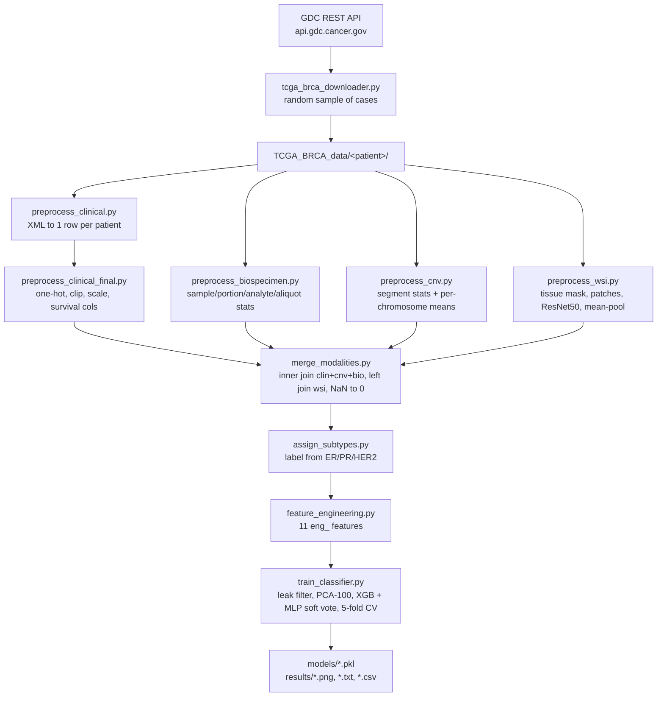
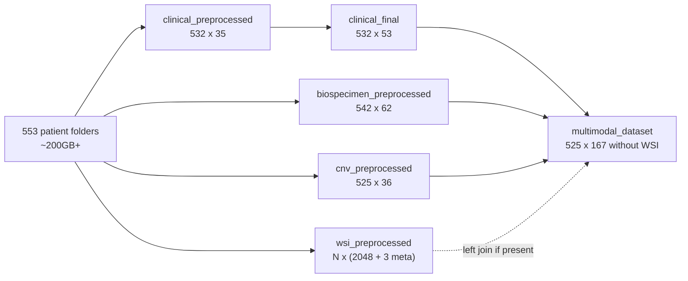
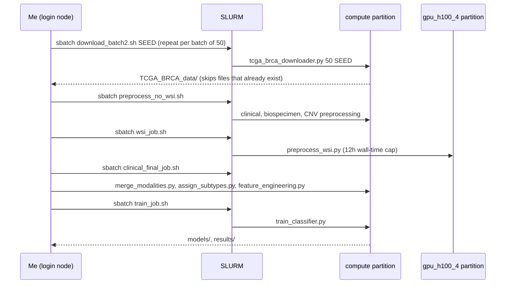

# TCGA-Classifier — Interview Deep-Dive

> **Who this is for:** me (the author), preparing to explain and defend this project in ML interviews.
> **How to read it:** each section starts with a plain-English summary. Technical detail comes after it. Jargon is defined the first time it appears, and the [Glossary](#glossary) at the end collects all the definitions.
> **Ground rules:** everything here comes from the code in this repo (`classification/*.py`, `*.sh`), the `README.md`, the `classification/TCGA_BRCA_Handover.docx`, and the git history. If a claim can't be checked against those, it's marked **UNVERIFIED**.

---

## 0. TL;DR (read this if you only have 2 minutes)

- **What:** a Python pipeline that downloads breast-cancer patient data from the US National Cancer Institute's public database (TCGA-BRCA via the GDC API). It turns four kinds of data into numbers: clinical records, DNA copy-number changes, sample-handling metadata, and microscope slide images. It then trains an XGBoost + neural-network ensemble to predict the patient's breast-cancer *subtype*.
- **Where it ran:** the BITS Pilani Hyderabad *Sharanga* HPC cluster, using SLURM job scripts and an H100 GPU for the slide images.
- **Biggest things to know before an interview:**
  1. The subtype **labels are computed from ER/PR/HER2 receptor status** (`classification/assign_subtypes.py`), and those same receptor fields are in the clinical data. `train_classifier.py` tries to drop the leaky columns, but **two engineered features (`eng_is_triple_negative`, `eng_is_luminal`) slip through its keyword filter**. That is label leakage.
  2. The **ROC-AUC printed by `train_classifier.py` is computed on the training data**: the model is fit on all of X and then predicts on the same X (`train_classifier.py:223-233`). It is not a held-out metric.
  3. The README's headline numbers (86% accuracy, 0.78 macro-F1, 0.95 ROC-AUC, 3 classes, SMOTE) **cannot be reproduced from the committed code**. The scripts it names (`train_xgboost_v2.py`, `dimensionality_reduction_v2.py`, `assign_subtypes_ihc.py`, `collect_wsi.py`, `config.yaml`) are not in the repo. The committed trainer is 5-class and uses no SMOTE. Treat those numbers as **UNVERIFIED**.

---

## 1. One-paragraph pitch (30-second interview answer)

"TCGA-Classifier is a multimodal machine-learning pipeline for breast-cancer subtyping. It pulls about 550 patients from The Cancer Genome Atlas through the GDC API. It then turns four very different data types into one feature table per patient: clinical XML records, DNA copy-number segment files, biospecimen metadata, and gigapixel whole-slide pathology images. For the images I tile each slide into tissue patches, run an ImageNet ResNet-50 on every patch, and average the results into one 2048-number vector per slide. The fused table goes into an XGBoost plus MLP soft-voting ensemble, evaluated with stratified 5-fold cross-validation. Everything ran as SLURM jobs on our university's H100 cluster. The longer-term goal is to see whether cheap, routine data like slide images can stand in for expensive molecular tests in low-resource hospitals."

*(Be ready for the follow-up: "how were the labels made?" See §7 and §10.)*

---

## 2. Plain-language explanation (for a smart non-engineer)

**The medical problem.** "Breast cancer" is not one disease. Doctors split it into *subtypes* that behave differently and need different drugs. The main test stains a tissue sample for three proteins on the tumour's surface:
- **ER** (estrogen receptor),
- **PR** (progesterone receptor),
- **HER2** (a growth-signal receptor).

Whether each one is present (+) or absent (−) decides the treatment. "Triple negative" means all three are absent, and it is the hardest subtype to treat. A more precise genetic test called **PAM50** exists, but it is expensive.

**What the project does.** Imagine a big filing cabinet with one drawer per patient. Each drawer holds four very different things:
1. a **doctor's form** (age, stage, receptor results, survival),
2. a **DNA "photocopier" report**: which parts of the tumour's chromosomes got extra copies or lost copies (this is called *copy number variation*, or CNV),
3. a **lab-handling sheet**: how many samples were taken, their weights, how they were preserved,
4. a **giant microscope photo** of the tumour tissue, often 100,000 × 100,000 pixels.

The pipeline:
1. downloads these drawers,
2. turns each item into a row of numbers,
3. glues the rows together,
4. trains a computer model to guess the subtype from the numbers.

For the photo, it cuts the tissue into small square tiles. It shows each tile to a pre-trained image-recognition network, which describes the tile as 2048 numbers. Then it averages all the tile descriptions into one summary per patient.

**The catch** (and you should know it). The "right answers" the model learns from were *calculated from the receptor results on the doctor's form*. If those same results, or features computed from them, are also given to the model as inputs, the model can "peek at the answer key". The code tries to hide them, but misses some. This is the most important weakness to own in an interview.

---

## 3. Architecture

### 3.1 Components

| Stage | Script | Input | Output |
|---|---|---|---|
| Download | `classification/tcga_brca_downloader.py` | GDC REST API | `TCGA_BRCA_data/<patient>/{Biospecimen,Clinical,Copy_Number_Variation,WSI}/` |
| Clinical parse | `classification/preprocess_clinical.py` | Clinical XML | `clinical_preprocessed.csv` |
| Clinical encode | `classification/preprocess_clinical_final.py` | `clinical_preprocessed.csv` | `clinical_final.csv`, `scaler.pkl`, `label_encoder.pkl` |
| Biospecimen | `classification/preprocess_biospecimen.py` | Biospecimen XML | `biospecimen_preprocessed.csv` |
| CNV | `classification/preprocess_cnv.py` | `*.txt` segment files | `cnv_preprocessed.csv` |
| WSI | `classification/preprocess_wsi.py` | `*.svs` slides | `wsi_features/*.npy`, `wsi_preprocessed.csv` |
| Merge | `classification/merge_modalities.py` | 3–4 CSVs | `multimodal_dataset.csv` |
| Labels | `classification/assign_subtypes.py` | `multimodal_dataset.csv` | adds `clin_pam50_subtype` (in place) |
| Features | `classification/feature_engineering.py` | `multimodal_dataset.csv` | `multimodal_engineered.csv` |
| (Optional) DR | `classification/dimensionality_reduction.py` | `multimodal_dataset.csv` | `multimodal_reduced.csv`, PCA pickles, scree plot |
| Train/eval | `classification/train_classifier.py` | `multimodal_engineered.csv` | `models/*.pkl`, `results/*` |
| Orchestration | `classification/*.sh` | — | SLURM jobs on Sharanga |
| Side script | `classification/fetch_pam50.py` | GDC `/cases` | `pam50_labels.csv` (38 hard-coded patients; not wired into the pipeline) |

### 3.2 Architecture diagram



### 3.3 Data-flow (shape of the data at each step)

The row and column counts below are the ones written in the handover document (`TCGA_BRCA_Handover.docx`, §3.3). They are not code outputs, so treat them as the author's own notes.



### 3.4 Run lifecycle on the HPC (sequence)



---

## 4. Tech stack

| Library / service | Used in | Why it was likely chosen | Realistic alternatives & trade-offs |
|---|---|---|---|
| **GDC REST API** + `requests` | downloader, `fetch_pam50.py` | The official open-access route to TCGA. JSON filters let you query by case, data type and access level. | `gdc-client` CLI (faster bulk transfer using manifests, but harder to filter per patient); TCGAbiolinks in R (rich, but R-only); cBioPortal (pre-processed and easier, but less raw). |
| `tqdm` | downloader, WSI | Progress bars for multi-GB downloads and patch loops. | `rich`; plain logging. |
| **lxml** (`etree`) | clinical/biospecimen parse | Fast XML parsing. `root.iter()` lets the code match on *local* tag names, which gets around TCGA's inconsistent XML namespaces. | `xml.etree.ElementTree` (stdlib, slower, same API); `xmltodict` (convenient, but the namespaces get messy). |
| **pandas / numpy** | everywhere | Tabular wrangling and merges. | polars (faster, but less familiar). |
| **scikit-learn** | scaling, PCA, MLP, VotingClassifier, CV, metrics | One API for preprocessing, models and evaluation. | PyTorch MLP (more control); statsmodels. |
| **XGBoost** | `train_classifier.py` | Strong default for small, mixed-type tabular data. It handles different feature scales and has built-in regularisation. | LightGBM (faster, similar accuracy); CatBoost (better with categoricals); RandomForest (simpler, a weaker baseline). |
| **OpenSlide** (`openslide-python`) | WSI | The standard reader for pyramidal `.svs` pathology slides. It reads any region at any pyramid level without loading the whole gigapixel image. | `tiffslide` (pure Python); `cuCIM` (GPU, faster); `pyvips`. |
| **OpenCV** (`cv2`) | tissue mask | HSV conversion, Otsu threshold, morphology: quick and well known. | scikit-image (similar). |
| **PyTorch + timm** | WSI features | `timm.create_model("resnet50", pretrained=True, num_classes=0)` gives a ready 2048-d feature extractor in one line. | Pathology foundation models (UNI, CONCH, CTransPath, Phikon), which are *much* better for histology, as the README's "Future Work" says; torchvision's ResNet. |
| `torchvision.transforms` | WSI | ImageNet resize and normalisation. | timm's own `resolve_data_config`. |
| **openpyxl** | every stage | Writes formatted Excel copies of every CSV, probably for supervisors or teammates who don't code. | Skip it (it's slow and adds nothing to the ML). |
| matplotlib / seaborn | DR, training | Scree plot, confusion matrix, ROC curves. | plotly. |
| **SLURM + conda + Spack modules** | `*.sh` | The cluster's scheduler. A100/H100 GPU access only goes through it. | Snakemake or Nextflow (proper DAG with resume), which would fix the manual chaining. |
| `imbalanced-learn` (SMOTE) | **nowhere in code** | Named in the README install line and "Results", but not imported by any committed script. | — |

---

## 5. Code walkthrough (module by module)

> Line numbers below are from the files as committed (HEAD `bc65599`).

### 5.1 `classification/tcga_brca_downloader.py` — fetching the data

- **Config (`:43-48`)**: `N_PATIENTS` and `RANDOM_SEED` come from `sys.argv`, so SLURM can run `tcga_brca_downloader.py 50 <seed>` (see `download_batch2.sh:18`). `DOWNLOAD_WSI = True` controls the multi-GB slides.
- **`get_random_cases` (`:71-91`)** POSTs to `/cases` with a filter on `project.project_id = TCGA-BRCA` and `"size": 1000`, then `random.Random(seed).sample(...)`.
  - *Non-obvious:* TCGA-BRCA has roughly 1,098 cases. GDC returns at most `size` hits, so this only ever samples from the **first 1,000 returned**. About 100 patients can never be picked. (This is from knowing the cohort size; the code doesn't paginate.)
  - *Non-obvious:* different seeds produce **overlapping** samples. Duplicates are harmless only because `download_file` skips files that already exist (`:120-122`).
- **`query_files_for_case` (`:95-112`)**: an `and` filter on `cases.case_id`, `data_category`, `data_type`, `access=open`.
- **`download_file` (`:116-135`)** streams in 8 KB chunks, with an idempotency check (skip if the file exists). This is what makes resubmitting failed jobs safe (the handover doc says: "If a job fails with SSL errors, simply resubmit").
  - *Bug risk:* a download that dies half-way leaves a **partial file**, and the next run will skip it as "already exists". There's no temp-file-then-rename and no size or MD5 check.
- **`download_cnv` (`:174-195`)** tries *Masked Copy Number Segment* first, then falls back to *Copy Number Segment*.
- **`_get_wsi_files` (`:218-235`)**: slides are `data_category=Biospecimen`, `data_type=Slide Image`, `experimental_strategy=Diagnostic Slide`. Diagnostic (FFPE) slides, not frozen-section "Tissue Slide" images, which is the right choice for morphology.

### 5.2 `classification/preprocess_clinical.py` — clinical XML → row

- **`find_clinical_xmls` (`:34-45`)** keeps only files named `*_clinical.*` that are not `biospecimen` or `ssf`.
- **`_find_tag` (`:48-55`)** is the "namespace-agnostic parsing" the README talks about. It walks *every* element and compares the **local** tag name (`el.tag.split("}")[-1]`). TCGA XML files use version-specific namespace URIs, so a namespaced XPath would break across files.
  - *Trade-off:* it returns the **first** match anywhere in the tree. If a tag appears in both the main record and a follow-up block, you get whichever comes first. Follow-up values may be silently ignored or used.
- **`parse_clinical_xml` (`:58-104`)** tries several alternative tag names per field (for example, ER status comes from `breast_carcinoma_estrogen_receptor_status` / `er_status_by_ihc` / `er_status`).
- **Normalisation (`:107-116`)** maps `[not available]`, `[unknown]` and similar to `None`.
- **Encoders (`:119-142`)**:
  - `_STAGE_MAP` maps stage text to 1–4. Note that "Stage X" and other unmapped values become `None`.
  - `encode_grade` takes the first digit 1–4 it finds.
  - `encode_binary` maps yes/positive → 1 and no/negative → 0. Anything else (e.g. "indeterminate", "equivocal") becomes `None`.
- **`build_dataframe` (`:145-171`)** builds the `*_binary` columns, **including `er_status_binary`, `pr_status_binary`, `her2_status_binary` (`:159-161`)**, and one-hot encodes demographics and histology.
- **`drop_high_missing` (`:174-181`)** drops a column if more than 60% of it is missing. **`impute_numeric` (`:184-188`)** fills the rest with the median **over the whole cohort**.
  - *Non-obvious & important:* the receptor binaries are numeric, so a patient with *missing* HER2 status gets the **cohort median** (almost certainly 0, i.e. HER2−). The label derived later inherits that guess.

### 5.3 `classification/preprocess_clinical_final.py` — encode & scale

- Adds **placeholder** `pam50_subtype` / `pam50_encoded` columns (`:164-165`). These are always `None` here; the label is filled later by `assign_subtypes.py`.
- **`engineer_survival` (`:42-58`)** sets `overall_survival_days = max(days_to_death, days_to_last_followup)` and `survival_event = (vital_status == "dead")`.
- **`onehot_encode_all` (`:61-80`)** one-hot encodes *every* remaining string column. That includes the raw `er_status`/`pr_status`/`her2_status` text, which produces columns like `er_status_positive`.
- **`clip_outliers` (`:83-93`)** winsorises four continuous columns to the 1st–99th percentile (it caps values beyond those points rather than deleting them). **`scale_features` (`:96-107`)** applies StandardScaler to the same four columns.
  - *Leakage note:* both the percentiles and the scaler are fit on **all patients before any train/test split**.
- The saved `label_encoder.pkl` (`:185-188`) is an **unfitted** `LabelEncoder()`. It's a placeholder with no real use.

### 5.4 `classification/preprocess_biospecimen.py` — sample metadata

- Walks the biospecimen hierarchy, **patient → sample → portion → analyte → aliquot**, using `_find_all(root, "sample")` and so on (`:64-66`, `:104-178`).
- Features (one row per patient):
  - counts: `n_samples_total`, `n_samples_tumor`, `n_portions`, `n_analytes_{dna,rna,protein}`, `n_aliquots`;
  - mean or max weights and concentrations;
  - flags derived from TCGA sample-type codes (`:124-128`): `has_primary_tumor` ("01"), `has_solid_normal` ("11"), `has_blood_normal` ("10"), `has_metastatic` ("06").
- *Non-obvious:* `_find(s, "sample_type")` searches the **whole subtree** under each sample, so it can pick up nested tags. `_find_all(root, "portion")` also counts portions from *all* samples, normals included.
- *Critical-thinking point:* most of these are **lab-process** variables (how much DNA was extracted, which plate). They can encode **batch effects** (the submitting tissue-source site, processing date) rather than biology. A classifier can exploit them as shortcuts. Note that `tissue_source_site` is one-hot encoded, and the 60%-missing filter doesn't remove it.

### 5.5 `classification/preprocess_cnv.py` — copy-number features

- **`find_cnv_files` (`:64-96`)** sorts each patient's `.txt` segment files by **file size** and assumes **larger = tumour, smaller = normal** (`:84-85`).
  - *This is a heuristic*. The README calls it "CNV Tumour/Normal Separation". The correct way is to parse the TCGA **sample-type code in the aliquot barcode** (positions 14–15: `01` = primary tumour, `10`/`11` = normal) or query GDC `cases.samples.sample_type`.
  - *Also:* if a patient has more than two files (several aliquots), only the smallest and largest are used.
- **`load_seg_file` (`:99-110`)** reads `Chromosome, Start, End, Num_Probes, Segment_Mean`. `Segment_Mean` is a log2 copy-ratio: 0 means normal, above 0 is a gain, below 0 is a loss.
- **`extract_features` (`:113-163`)**:
  - Optional "baseline correction" (`:124-132`) subtracts the **per-chromosome mean of the normal sample** from each tumour segment.
    - *Debatable:* GDC segment means are already relative to a reference, and in masked tumour files germline CNVs are already removed. Subtracting a whole-chromosome mean of the normal file is a crude correction that can introduce noise.
  - Gain/loss use ±0.2 thresholds (`:56-57`, a common convention).
  - `pct_genome_gained/lost` are **length-weighted** (`:143-146`).
  - `mean_segment_mean` and the per-chromosome `chrN_mean` (`:158-161`) are **unweighted** by segment length. One tiny focal amplification counts as much as a whole-arm event.
    - *Biological consequence:* the HER2 gene (ERBB2) sits on a small region of chr17q12. Averaging the whole of chr17 dilutes exactly the focal HER2 amplification signal the README says it captures.
- Then: drop columns with >60% missing, median-impute, and StandardScaler on all non-binary numerics (`:189-208`). As before, these are **fit on the full cohort**.

### 5.6 `classification/preprocess_wsi.py` — whole-slide images → 2048-d vector

The pipeline:
1. **`find_wsi_files` (`:73-89`)** takes only the **first** `.svs` per patient (`svs_files[0]`), and `glob` order is not guaranteed.
2. **`get_level_for_mag` (`:93-105`)** reads `openslide.objective-power` (defaulting to 40). It computes `downsample = native/20` and calls `get_best_level_for_downsample`.
   - *Subtle bug:* TCGA SVS pyramids are usually downsampled by 1×, 4×, 16× and so on. For a 40× slide the requested downsample is 2, and OpenSlide returns the best level **at or below** 2, which is **level 0 (40×)**. Patches are then read as 512×512 *at 40×*, which covers the field of view of a 256×256 patch at 20×. So the "20× magnification" claim is only true for slides scanned natively at 20×. Magnification is **inconsistent across the cohort**.
   - The right fix is to read at level 0 with `patch_size * native/20` pixels and resize, or use the nearest higher-resolution level and resize.
3. **`get_tissue_mask` (`:109-130`)**: takes the thumbnail at the lowest-resolution level, converts it to HSV, applies **Otsu's threshold on saturation** (tissue is pink/purple and saturated; background glass is white and unsaturated), then does a 5×5 morphological close then open.
4. **`get_patch_coords` (`:134-173`)** walks a non-overlapping grid at level-0 coordinates. It maps each patch to thumbnail coordinates and keeps it if the tissue fraction is at least `TISSUE_THRESHOLD = 0.5`.
   - *Edge case:* `range(0, h0 - patch_size_l0, …)` drops the last partial row and column. That's fine.
5. **`load_model` (`:177-190`)**: `timm.create_model("resnet50", pretrained=True, num_classes=0)`, where `num_classes=0` removes the classifier head, so the output is the 2048-d global-average-pooled features.
6. **`get_transforms` (`:193-203`)** resizes 512 → 224 with ImageNet mean/std. Each patch is **downsampled about 2.3×** before the CNN sees it, so fine nuclear detail is partly lost.
7. **`extract_features` (`:207-241`)** processes batches of 16 under `torch.no_grad()`.
   - Unreadable patches are silently skipped.
   - If *every* patch fails, it returns a **zero vector** (`:238-239`), and that patient becomes indistinguishable from "no slide".
8. **`process_patient` (`:245-300`)** saves the raw N×2048 matrix to `wsi_features/<pid>_patch_features.npy`, then **mean-pools** to a 1×2048 vector and adds `n_patches`, `slide_w`, `slide_h`.
9. **`main` (`:355-411`)** writes `wsi_preprocessed.csv` **only after all slides finish**.
   - *Operational risk:* the GPU partition has a **12-hour wall-time cap** (`wsi_job.sh:7`, handover §7). If the job is killed, the per-patient `.npy` files survive but the CSV is never written. The script also has no "skip patients that already have a `.npy`" logic, so a resubmit starts from scratch.
   - The handover doc lists `wsi_preprocessed.csv` as "RUNNING — not yet complete".

### 5.7 `classification/merge_modalities.py` — fuse

- `load_and_prefix` (`:36-49`) prefixes columns with `clin_`, `cnv_`, `bio_` or `wsi_`, so their origin stays visible.
- **Joins (`:169-178`)**: clinical ⋈ CNV ⋈ biospecimen are **inner** joins, so only patients with all three survive. WSI is a **left** join, so patients without slides are kept.
- **`df.fillna(0)` (`:194`)**: every remaining NaN becomes 0, including the 2051 WSI columns of patients **without a slide**.
  - The model can't tell "no slide" from "a slide whose features are all zero".
  - Because the other modalities are standardised, 0 also means "exactly average", which is a strong and false assumption.
- *Inconsistency:* `pam50_subtype` / `pam50_encoded` are kept **unprefixed** (`:156`), but `assign_subtypes.py` and `train_classifier.py` use `clin_pam50_subtype`. The unprefixed placeholder becomes 0 after `fillna` and is later removed by the leak filter, so it does no harm. It is dead weight.

### 5.8 `classification/assign_subtypes.py` — **where the labels come from**

```python
# classification/assign_subtypes.py:7-24 (abridged)
if her2 == 1 and er == 0 and pr == 0:      return "HER2-enriched"
elif er == 0 and pr == 0 and her2 == 0:    return "Basal-like"
elif (er == 1 or pr == 1) and her2 == 1:   return "Luminal B"
elif (er == 1 or pr == 1) and her2 == 0:   return "Luminal A"
else:                                      return "Normal-like"
```

- This is an **IHC surrogate**, not PAM50. Real PAM50 is a 50-gene expression signature from RNA. The handover doc admits it: "PAM50 labels are derived from receptor status… This is a clinical approximation."
  - Clinically, "Luminal A vs B" also depends on Ki-67 and grade, and many ER+/HER2− tumours are Luminal B by PAM50.
- "Normal-like" can only happen when a value is not 0/1. After `fillna(0)` and median imputation that almost never happens, so **that class is effectively empty**.
- It **overwrites `multimodal_dataset.csv` in place** (`:28`), so the pipeline is not idempotent.
- `fetch_pam50.py` tried to get real subtypes from GDC's `diagnoses.subtype` for 38 hard-coded patients. It is not used anywhere, which is consistent with GDC not exposing PAM50 there (handover: "not from the GDC API which does not provide them").

### 5.9 `classification/feature_engineering.py` — 11 engineered features

| # | Feature (`:47-133`) | What it is | Problem |
|---|---|---|---|
| 1 | `eng_receptor_subtype_code` | ER·4 + PR·2 + HER2 | **is the label, re-encoded** (dropped by the trainer's filter: contains "receptor") |
| 2 | `eng_is_triple_negative` | ER=PR=HER2=0 | **is exactly the "Basal-like" label**, and **NOT caught by the leak filter** |
| 3 | `eng_is_her2_positive` | HER2=1 | dropped (contains "her2") |
| 4 | `eng_is_luminal` | ER or PR = 1 | **is exactly "Luminal A or B"**, and **NOT caught by the leak filter** |
| 5 | `eng_genomic_instability_score` | weighted sum of 5 CNV columns | the inputs are **already standardised**, so the "weights" combine z-scores |
| 6 | `eng_gain_loss_ratio` | gained / (lost + 1e-6) | both inputs are **standardised** (can be negative or near 0), so the ratio is meaningless and can explode to ±10⁶ |
| 7 | `eng_chr17_her2_interaction` | chr17 mean × HER2 | contains HER2 (dropped by the filter) |
| 8 | `eng_chr8_chr16_ratio` | chr8 / abs(chr16) | ratio of z-scores, same explosion risk |
| 9 | `eng_wsi_patch_density` | n_patches / (pixels/1e8) | fine; but 0 for patients without WSI |
| 10 | `eng_age_stage_interaction` | age × stage | both are z-scores |
| 11 | `eng_survival_age_ratio` | OS days / age | uses **survival outcome** (future information), and both inputs are z-scores |

### 5.10 `classification/dimensionality_reduction.py` — optional PCA

- `apply_wsi_pca` (`:69-97`) standardises the WSI columns, fits PCA (`N_WSI_COMPONENTS = 50`), and replaces the `wsi_*` columns with `wsi_pca_1..50`.
  - *Bug:* `wsi_cols` is "every column starting with `wsi_`", so it **also sweeps in `wsi_n_patches`, `wsi_slide_w`, `wsi_slide_h`** and mixes this metadata into the image PCs.
- `apply_full_pca` is behind `APPLY_FULL_PCA = False`.
- **Not connected to training:** the training script reads `multimodal_engineered.csv` (`train_classifier.py:59`), not `multimodal_reduced.csv`, and the script's own final message says "Update DATA_CSV in train_classifier.py…".
- The README's "2048 → 50 dimensions, 94.1% variance retained" is **not** in any committed output. **UNVERIFIED**.

### 5.11 `classification/train_classifier.py` — model & evaluation

- **Config (`:59-99`)**:
  - `LABEL_COL = "clin_pam50_subtype"` and 5 PAM50 classes.
  - XGBoost: 200 trees, depth 3, lr 0.05, subsample 0.8, colsample 0.3, L1 = 1, L2 = 2, min_child_weight 5. This is reasonable regularisation for about 500 rows.
  - MLP: layer sizes depend on the `N_PATIENTS` environment variable (`:90-93`).
    - *Gotcha:* `train_job.sh` never sets `N_PATIENTS`, so it defaults to 10 → `(256,128,64)` **with early stopping off** (`:96`).
- **`prepare_features` (`:109-161`)**:
  - Drops `patient_id` and the encoded label.
  - **The leak filter (`:119-131`)**: drops any column containing `er_status`, `pr_status`, `her2`, `estrogen`, `progesterone`, `receptor`, `pam50` or `subtype`.
    - *What it misses:* `eng_is_triple_negative` and `eng_is_luminal`. I checked this by running the same keyword test over the column names.
  - A **"dry-run" fallback (`:142-151`)** assigns round-robin dummy labels when no real labels exist. It's fine for smoke tests, but dangerous because it fails silently: it prints a warning and still writes "results".
- **`apply_pca` (`:164-171`)**: PCA to 100 components on the **whole X before cross-validation**. That's unsupervised leakage, the mild kind.
  - *Worse:* the columns are on **wildly different scales**. `wsi_slide_w`/`slide_h` are in tens of thousands of pixels, `cnv_total_genome_length` was scaled but the ratio features can be about 10⁶, and the binary flags are 0/1. PCA maximises variance, so the first components will be dominated by whichever raw columns have the biggest numbers, not by information content.
- **`build_models` (`:174-188`)**: XGB (`multi:softprob`) + MLP in a `VotingClassifier(voting="soft", weights=[1,1])`. This averages their predicted probabilities.
- **`evaluate_model` (`:191-243`)**:
  - Uses `StratifiedKFold(5, shuffle, seed 42)`, or Leave-One-Out if n < 10. `cross_validate` gives held-out accuracy, weighted-F1 and macro-F1. ✅
  - **ROC-AUC (`:222-233`)** does `model.fit(X, y)` and then `predict_proba(X)` on **the same data**. That is training-set AUC, and it will be close to 1.0 for boosted trees. ❌
- **Reporting (`:357-395`)**:
  - The confusion matrix and `classification_report.txt` use `cross_val_predict` (held-out folds). ✅ The comment says "honest reporting".
  - The ROC curve plot is explicitly titled "train set". ✅ It's labelled honestly, but it's still the wrong thing to report.
- Everything is pickled to `models/`.

---

## 6. Core concepts & theory

### 6.1 Breast-cancer subtypes: IHC surrogate vs PAM50
- **IHC (immunohistochemistry):** an antibody stain on a tissue slice that shows whether a protein (ER, PR, HER2) is present. It's cheap and routine.
- **PAM50:** a 50-gene RNA-expression classifier (Parker et al., 2009). It defines the *intrinsic* subtypes: Luminal A, Luminal B, HER2-enriched, Basal-like, Normal-like.
- IHC → PAM50 agreement is imperfect. Roughly speaking, triple-negative ≈ Basal-like, but not one-to-one.
- **Interview point:** predicting an IHC-derived label from features that include IHC is circular. The scientifically interesting task is predicting **PAM50** (from RNA-seq, which TCGA *does* provide, e.g. via the TCGA PanCancer Atlas or TCGAbiolinks) from **non-IHC** inputs like H&E morphology or CNV.

### 6.2 Copy number variation (CNV) and segment means
- Cancer cells often gain or lose chunks of chromosomes.
- Microarray or sequencing probes measure the DNA amount at each position. A *segmentation* algorithm (CBS, circular binary segmentation) merges neighbouring probes into **segments** that each have one value: `Segment_Mean = log2(copy_number / 2)`.
  - 0 means the normal 2 copies, +0.58 means 3 copies, −1 means 1 copy.
- Thresholds of ±0.2 are a common call for "gain/loss" (roughly a 15% change).
- *Biology the README cites:*
  - HER2 tumours amplify **ERBB2 on chr17q12**.
  - Luminal tumours often show **1q gain / 16q loss**. The README says "chr8/chr16"; 8q gain (MYC) is common too.
  - Basal-like tumours show high genome-wide instability.

### 6.3 Whole-slide images, pyramids and tissue detection
- An `.svs` file is a **pyramid**: level 0 is full resolution (20× or 40× objective), and higher levels are downsampled copies. OpenSlide reads any rectangle at any level.
- **Otsu's method** picks the threshold *t* that maximises the between-class variance of the histogram:
  $$\sigma_B^2(t) = \omega_0(t)\,\omega_1(t)\,[\mu_0(t)-\mu_1(t)]^2$$
  Here ω are the class probabilities and μ the class means. Applied to the HSV *saturation* channel, it separates stained tissue from white glass.
- Morphological **closing** (dilate then erode) fills small holes. **Opening** (erode then dilate) removes specks.

### 6.4 Transfer learning with ResNet-50 and mean pooling
- A ResNet-50 pre-trained on ImageNet turns a 224×224 RGB image into a 2048-d vector (after global average pooling). Its convolutional filters detect generic textures and edges that partly transfer to histology.
- **Mean pooling** across N patches gives $\bar{h} = \frac{1}{N}\sum_i h_i$.
  - It's simple and invariant to the order and number of patches.
  - But it **washes out rare, informative regions**. A small tumour focus is averaged with lots of stroma.
- **Multiple-instance learning (MIL)** treats the slide as a "bag" of patches with a single label. **Attention-MIL** (Ilse et al., 2018) learns a weight per patch:
  $$a_i = \frac{\exp\{w^\top \tanh(V h_i)\}}{\sum_j \exp\{w^\top \tanh(V h_j)\}},\quad z=\sum_i a_i h_i$$
  This is the standard upgrade, and the README lists it as future work.

### 6.5 Gradient-boosted trees (XGBoost)
- Builds trees one after another. Each new tree $f_t$ fits the negative gradient of the loss with respect to the current predictions.
- XGBoost minimises a regularised objective:
  $$\mathcal{L} = \sum_i \ell(y_i, \hat{y}_i) + \sum_t \Big(\gamma T_t + \tfrac{1}{2}\lambda\lVert w_t\rVert^2 + \alpha\lVert w_t\rVert_1\Big)$$
  where $T_t$ is the number of leaves and $w_t$ the leaf weights. `reg_lambda=2`, `reg_alpha=1` and `min_child_weight=5` all control overfitting.
- It uses a second-order (Newton) approximation. The optimal leaf weight is $w^* = -\frac{\sum g_i}{\sum h_i + \lambda}$.
- **multi:softprob** builds one tree per class per round and applies a softmax:
  $$p_k = \frac{e^{z_k}}{\sum_j e^{z_j}},\quad \ell = -\sum_k y_k \log p_k$$
  The second formula is the cross-entropy, also called log-loss.
- `colsample_bytree=0.3` means each tree sees 30% of the columns. That's useful when one modality (WSI, 2048 columns) dwarfs the others.

### 6.6 MLP and soft voting
- `MLPClassifier`: fully connected ReLU layers trained with Adam on cross-entropy.
- **Soft voting:** $p_{\text{ens}} = \tfrac{1}{2}(p_{\text{xgb}} + p_{\text{mlp}})$, then argmax. It helps when the two models make **different** errors.

### 6.7 PCA
- Finds orthogonal directions of maximum variance: the eigenvectors of the covariance $\Sigma = \frac{1}{n}X_c^\top X_c$, ordered by eigenvalue λ.
- "Explained variance ratio" $=\lambda_k/\sum_j\lambda_j$.
- **PCA is scale-sensitive.** Features must be standardised first, or large-unit columns dominate. `dimensionality_reduction.py` does standardise; `train_classifier.apply_pca` does **not**.
- With n ≈ 500 rows, at most n−1 components exist.

### 6.8 Cross-validation & leakage
- **Stratified k-fold:** k folds that each keep the class proportions. You train on k−1 folds, test on the remaining one, and average.
- **Leakage** means any information from the evaluation fold reaching training. In this repo:
  1. **Target leakage (severe):** features that are functions of the label.
  2. **Preprocessing leakage (mild):** scalers, imputers and PCA fitted on all rows.
- The fix for (2) is an sklearn `Pipeline` placed **inside** CV. The fix for (1) is not including those features at all.

### 6.9 Metrics
- **Accuracy** = correct / total. It's misleading with class imbalance (Luminal A dominates).
- **Per-class F1** = $2PR/(P+R)$. **Macro-F1** is the unweighted mean over classes (rare classes count equally). **Weighted-F1** weights by support.
- **One-vs-rest ROC-AUC:** for each class *k*, the probability that a random positive is scored above a random negative. "Macro" averages these over classes. It's threshold-free, but only meaningful on held-out predictions.

---

## 7. Data

### 7.1 Source
- **TCGA-BRCA** via the NCI **Genomic Data Commons**. All files used are open access (`access=open` in every query), so no dbGaP token is needed.

### 7.2 Schema (per patient, after preprocessing)

| Modality | Prefix | Approx. columns | Examples |
|---|---|---|---|
| Clinical | `clin_` | 53 (handover) | age, stage_numeric, grade_numeric, er/pr/her2 binaries & one-hots, survival days/event, demographics one-hot |
| CNV | `cnv_` | 36 (handover) | n_segments, n_gain/loss_segments, pct_genome_gained/lost, chr1..22,X,Y means |
| Biospecimen | `bio_` | 62 (handover) | sample/portion/analyte/aliquot counts, weights, concentrations, `has_*` flags, tissue_source_site one-hots |
| WSI | `wsi_` | 2048 + 3 | `wsi_feat_0..2047`, `n_patches`, `slide_w`, `slide_h` |
| Engineered | `eng_` | 11 | see §5.9 |
| Label | `clin_pam50_subtype` | 1 | Basal-like / HER2-enriched / Luminal A / Luminal B / (Normal-like) |

### 7.3 Preprocessing summary
- Missing-value tokens → NaN.
- Drop columns with >60% missing.
- Median-impute numerics.
- One-hot encode categoricals.
- Winsorise and scale 4 clinical continuous columns; scale all non-binary CNV and biospecimen numerics.
- After the merge, fill NaN with 0.

### 7.4 Splits
- **No fixed held-out test set.** `TEST_SIZE = 0.2` is defined (`train_classifier.py:69`) but **never used**.
- Evaluation is stratified 5-fold CV on all labelled patients.
- One row = one patient, so there is no patient overlap between folds. ✅

### 7.5 Leakage risks (ranked)

| # | Risk | Where | Severity | Handled? |
|---|---|---|---|---|
| 1 | Label defined from ER/PR/HER2, which are also inputs | `assign_subtypes.py`, `preprocess_clinical.py:159-161` | **Critical** | Partly: the keyword filter at `train_classifier.py:119-131` |
| 2 | `eng_is_triple_negative`, `eng_is_luminal` are the label | `feature_engineering.py:64-77` | **Critical** | **No.** They bypass the filter |
| 3 | Missing receptor status median-imputed, *then* used to make labels | `preprocess_clinical.py:184-188` | High (label noise) | No |
| 4 | ROC-AUC on training data | `train_classifier.py:223-233` | High (inflated metric) | Disclosed in the plot title only |
| 5 | Scaler, imputer, winsorising and PCA fit on all rows before CV | multiple | Low–medium | No |
| 6 | Batch effects / shortcut features (tissue_source_site, plate and concentration stats) | `preprocess_biospecimen.py` | Medium | No |
| 7 | Survival outcome used as a feature (`overall_survival_days`, `eng_survival_age_ratio`) | `preprocess_clinical_final.py:42-58`, FE #11 | Medium (not available at diagnosis) | No |

---

## 8. Evaluation & results

### 8.1 What the code measures
- **Held-out:** 5-fold stratified CV accuracy (mean ± std), weighted-F1 and macro-F1 for XGB, MLP and the Ensemble (`train_classifier.py:209-220`). Also the ensemble's CV confusion matrix and per-class report.
- **Not held-out:** "ROC-AUC macro" in `metrics_summary.csv` and the ROC plot.

### 8.2 What the results actually are
- **No result files are committed.** There are no `results/`, `models/`, logs or notebooks in the repo, so **no metric can be verified from the repository.**
- The README reports: accuracy 0.86, macro-F1 0.78, ROC-AUC 0.95, and per-class (HER2_Positive 0.89/0.74/0.81, Luminal_A 0.87/0.96/0.91, Triple_Negative 0.75/0.54/0.63).
  - These describe a **3-class** problem (`Luminal_A / HER2_Positive / Triple_Negative`) trained with **"XGBoost + SMOTE"** by `train_xgboost_v2.py`. **None of that code is in the repo.**
  - The committed `train_classifier.py` is **5-class** and uses **no SMOTE**.
  - → **UNVERIFIED.** In an interview, say they came from a later iteration that wasn't committed, *if that's true*, and fix the repo before relying on them.
- *Sanity check on those numbers:* if the label-identical features had leaked into that model, Triple_Negative recall would be close to 1.0, not 0.54. So the uncommitted v2 probably did remove them, or had PCA that diluted them. You can't tell from the repo, so say so.

### 8.3 Is the evaluation sound?
- ✅ Stratified CV, patient-level rows, and per-class report from held-out predictions.
- ❌ Target leakage via `eng_is_triple_negative` / `eng_is_luminal`.
- ❌ Training-set AUC.
- ❌ Preprocessing fitted outside CV.
- ❌ No baseline. A majority-class baseline, or "IHC rule = label" (trivially 100%), would show what the model adds.
- ❌ No confidence intervals beyond the fold std, and no repeated CV. With about 500 patients, a ±3–4 point swing in macro-F1 is plausible from fold noise alone.
- ❌ No **modality ablation**, even though the README motivates the project with "quantify modality contribution".
- ❌ No external validation (e.g. CPTAC-BRCA, or a site-held-out split by `tissue_source_site` to detect batch shortcuts).

---

## 9. Design decisions & trade-offs

| Decision | Gained | Lost |
|---|---|---|
| **Early fusion** (concatenate all modality features into one table) | Simple; any tabular model works; easy to add modalities | WSI's 2048 columns swamp the ~150 others; no modality-specific modelling; missing-modality handling is crude (`fillna(0)`) |
| **Frozen ImageNet ResNet-50 + mean pool** | No GPU training needed; runs in one pass; reproducible | Domain gap (natural images vs H&E); mean pooling loses rare regions; inconsistent magnification (§5.6) |
| **Hand-crafted CNV summaries** (~36 numbers) instead of gene-level CN | Tiny, interpretable features | Throws away focal events (ERBB2) that matter most for subtype |
| **IHC-surrogate labels** | Available for nearly every patient without extra downloads | Circular with inputs; not true PAM50; Luminal A/B split clinically weak |
| **Many single-purpose scripts + CSV handoffs** | Each step is debuggable and re-runnable on its own; Excel copies for collaborators | No dependency graph and no resume; in-place overwrites (`assign_subtypes.py`) make re-runs order-dependent |
| **SLURM + scratch storage** | Access to H100s and ~200 GB of storage | Scratch auto-deletes after 15 days (handover §3.3); hard-coded `/scratch/spanda/...` paths make it non-portable |
| **XGBoost + MLP soft voting** | Combines a tree model with a smooth model | MLP on ~500 rows × 100 PCs adds little; equal weights not tuned |
| **Keyword-based leak filter** | Quick | Brittle: misses features whose names don't contain the keywords |

---

## 10. Honest weaknesses (find them before the interviewer does)

1. **Target leakage still present.** `eng_is_triple_negative` and `eng_is_luminal` (`feature_engineering.py:64-77`) are deterministic functions of the label and pass the keyword filter (`train_classifier.py:119-131`). Any metric from the committed trainer is suspect.
2. **The task is circular even without leakage.** Labels are a deterministic rule on IHC fields. The model is learning to reconstruct a rule from correlated signals, not to discover biology. Real PAM50 labels (RNA-seq) were never integrated. `fetch_pam50.py` is an abandoned attempt.
3. **ROC-AUC is in-sample** (`train_classifier.py:223-233`). It must not be quoted as a generalisation metric.
4. **README ↔ code mismatch.** The README names 8 files that don't exist and describes a different model (3-class, SMOTE, class weights, LDA, mutual-information selection) than the committed one. Results are not reproducible from the repo.
5. **PCA on unscaled, mixed-unit features** (`train_classifier.py:164-171`). Components are dominated by raw pixel dimensions and exploding ratio features.
6. **Engineered features computed on z-scores** (`feature_engineering.py:79-133`): ratios of standardised values can divide by numbers near zero and explode to ~10⁶.
7. **WSI magnification bug** (`preprocess_wsi.py:93-105`): 40× slides are read at 40×, not 20×.
8. **WSI pipeline not resumable** and only writes the CSV at the end. It's incompatible with a 12-hour GPU wall-time over 553 slides.
9. **Missing slides → zero vectors** (`merge_modalities.py:194`; `preprocess_wsi.py:238-239`).
10. **CNV tumour/normal decided by file size** (`preprocess_cnv.py:76-85`), not by barcode sample type.
11. **Partial downloads treated as complete** (`tcga_brca_downloader.py:120-122`). There's no checksum, although GDC provides MD5s.
12. **Cohort sampling capped at the first 1000 GDC hits** (`tcga_brca_downloader.py:79`).
13. **Fit-on-all preprocessing** (imputer, scaler, winsoriser, PCA) outside CV.
14. **No tests, no `requirements.txt`, no pinned versions, no config file**. Paths and parameters are hard-coded. Install instructions exist only in the README and handover.
15. **`use_label_encoder`** in `XGB_PARAMS` (`train_classifier.py:83`) is deprecated or removed in recent XGBoost. Depending on the version it warns or is ignored.
16. **Silent dry-run mode** (`train_classifier.py:142-151`) can produce plausible-looking result files from dummy labels.
17. **Authorship & environment provenance.** The first commit is authored by "Antigravity" (an AI coding agent), and all HPC paths point at `/scratch/spanda/...`. Be ready to explain clearly what *you* designed and ran versus what tools or collaborators produced. The handover doc reads like it was written for someone *taking over* the project.

---

## 11. How I'd improve it (prioritised)

| # | Change | Effort | Expected impact |
|---|---|---|---|
| 1 | **Remove leakage properly.** Use an explicit *allow-list* of feature columns per modality, not a keyword deny-list. Drop all receptor-derived inputs when the label is receptor-derived. Add a unit test asserting no feature has |corr| > 0.95 with the label | 0.5 day | Makes every number trustworthy; probably *lowers* the scores |
| 2 | **Get real PAM50 labels** (TCGA PanCancer Atlas `PAM50Call_RNAseq`, or TCGAbiolinks `TCGAquery_subtype("BRCA")`) and keep IHC as an input or a separate comparison | 1 day | Makes the task scientifically meaningful (predict molecular from morphology/CNV) |
| 3 | **Wrap preprocessing + model in an sklearn `Pipeline`** (imputer → scaler → PCA → model) evaluated with `cross_validate`. Compute ROC-AUC from `cross_val_predict(..., method="predict_proba")` | 0.5 day | Removes the in-sample AUC and preprocessing leakage |
| 4 | **Commit the actual training code behind the README numbers**, or delete the numbers. Add `results/` with metrics JSON, the confusion matrix and the git hash | 0.5 day | Reproducibility and credibility |
| 5 | **Baselines + ablations**: majority class, clinical-only, CNV-only, WSI-only, all-but-X. Use repeated stratified CV (5×5) with 95% CIs | 1 day | Answers the README's own "modality contribution" question |
| 6 | **Fix the WSI magnification** (read at level 0 with a scaled patch size, or use MPP metadata), make extraction resumable (skip existing `.npy`, write a per-patient CSV row), and record missing-slide indicators instead of zeros | 1 day | Correct, consistent image features; survives wall-time kills |
| 7 | **Swap ResNet-50 for a pathology foundation model** (UNI / CONCH / CTransPath / Phikon) and replace mean pooling with **attention-MIL** trained on patch features | 3–5 days (GPU) | Likely the largest real gain for morphology → subtype |
| 8 | **Gene-level CNV for key loci** (ERBB2, MYC, CCND1, FGFR1, 1q, 16q) using segment overlap, length-weighted chromosome-arm means, and barcode-based tumour/normal selection | 1 day | Better genomic signal, biologically defensible |
| 9 | **Turn the scripts into a Snakemake/Nextflow DAG** with a `config.yaml`, conda `environment.yml` and SLURM profile | 1–2 days | Resume, provenance, portability off `/scratch/spanda` |
| 10 | **Site-held-out validation** (group k-fold by `tissue_source_site`) and drop or flag biospecimen process variables | 0.5 day | Detects batch-effect shortcuts |
| 11 | Download integrity: GDC MD5s, temp-file + rename, paginate `/cases` | 0.5 day | Correct, complete cohort |

---

## 12. How to run it

> The scripts expect to be run **from the data directory** (they use relative paths like `TCGA_BRCA_data/`, `clinical_final.csv`). On Sharanga that's `/scratch/spanda/tcga_brca_data_classification`.

**Environment** (no lock file in the repo; the package list is from the README):
```bash
conda create -n tcga_env python=3.11      # handover doc says the cluster env is Python 3.10
conda activate tcga_env
pip install pandas numpy scikit-learn torch torchvision timm xgboost \
            openslide-python openslide-bin opencv-python lxml openpyxl \
            matplotlib seaborn requests tqdm scipy pillow
```

**Pipeline** (commands that match files actually in the repo):
```bash
mkdir -p work && cd work
python ../classification/tcga_brca_downloader.py 50 42      # N_PATIENTS SEED
python ../classification/preprocess_clinical.py
python ../classification/preprocess_clinical_final.py
python ../classification/preprocess_biospecimen.py
python ../classification/preprocess_cnv.py
python ../classification/preprocess_wsi.py                  # GPU strongly recommended
python ../classification/merge_modalities.py
python ../classification/assign_subtypes.py                  # overwrites multimodal_dataset.csv
python ../classification/feature_engineering.py
python ../classification/train_classifier.py
```

**On SLURM:** `sbatch classification/download_batch2.sh <seed>`, `sbatch classification/preprocess_no_wsi.sh`, `sbatch classification/wsi_job.sh`, `sbatch classification/clinical_final_job.sh`, `sbatch classification/train_job.sh`. These scripts hard-code `/scratch/spanda/...` and `~/classification/`, so edit them first.

**Environment variables (names only):**
- `N_PATIENTS`: read by `train_classifier.py:90` to size the MLP.
- `PYTHONPATH`: set by the SLURM scripts to the scratch package dir.
- `SCRATCH`: used in `download_job.sh:20`.

No API keys are needed (open-access data only).

**README commands that will fail:** `dimensionality_reduction_v2.py`, `train_xgboost_v2.py` (the files don't exist).

---

## 13. Resume bullets (truthful, evidenced)

- Built a **4-modality TCGA-BRCA data pipeline** (clinical XML, CNV segments, biospecimen XML, whole-slide images) that pulls ~550 patients from the NCI GDC API and fuses them into a single patient-level feature table, running as **SLURM jobs on an H100 HPC cluster**.
- Implemented **gigapixel whole-slide image feature extraction** with OpenSlide: Otsu tissue segmentation, 512-px patch tiling and **ImageNet ResNet-50 embeddings mean-pooled into 2048-d slide vectors**, GPU-batched in PyTorch/timm.
- Wrote **namespace-agnostic XML parsers** for TCGA clinical and biospecimen records and **copy-number summarisation** (genome-fraction gained/lost, per-chromosome log2 ratios) to turn heterogeneous genomics files into ML-ready features.
- Trained an **XGBoost + MLP soft-voting ensemble** with stratified 5-fold CV for IHC-surrogate subtype prediction; identified and documented **label-leakage and in-sample-AUC issues** in the evaluation *(only claim this once you've fixed them)*.

> ⚠️ Don't put "86% accuracy / 0.95 AUC" on your CV until the code that produced it is committed and the leakage fix is in. An interviewer who clones the repo will find the gap.

---

## Glossary

- **TCGA**: The Cancer Genome Atlas, a public multi-omics cancer dataset. **BRCA** = its breast cancer cohort.
- **GDC**: Genomic Data Commons, the NCI portal and API hosting TCGA.
- **IHC**: immunohistochemistry, antibody staining for proteins like ER, PR and HER2.
- **PAM50**: a 50-gene expression test defining intrinsic breast-cancer subtypes.
- **CNV**: copy number variation, gains or losses of DNA segments.
- **Segment mean**: the log2 copy ratio for a contiguous genomic segment.
- **WSI / SVS**: whole-slide image; `.svs` is Aperio's pyramidal TIFF format.
- **Otsu threshold**: an automatic threshold that best separates a two-peaked histogram.
- **ResNet-50**: a 50-layer residual CNN; its penultimate layer gives a 2048-d embedding.
- **Mean pooling / MIL**: aggregating many patch vectors into one slide vector by averaging (mean pooling) or learned weighting (MIL).
- **XGBoost**: a regularised gradient-boosted decision tree library.
- **Soft voting**: averaging the predicted probabilities of several models.
- **PCA**: principal component analysis, linear dimensionality reduction by variance.
- **Stratified k-fold CV**: splitting the data into k folds with the same class mix, rotating which fold is the test set.
- **Leakage**: information from the answer reaching the model during training or evaluation.
- **SLURM**: the job scheduler on HPC clusters (`sbatch`, `squeue`).
- **Winsorising**: capping extreme values at chosen percentiles.
